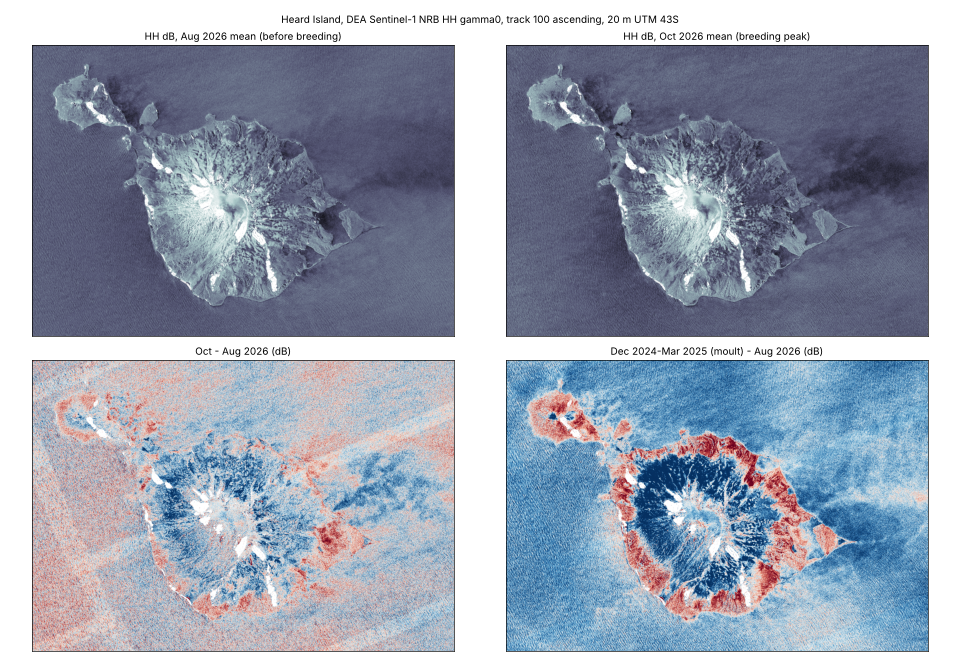
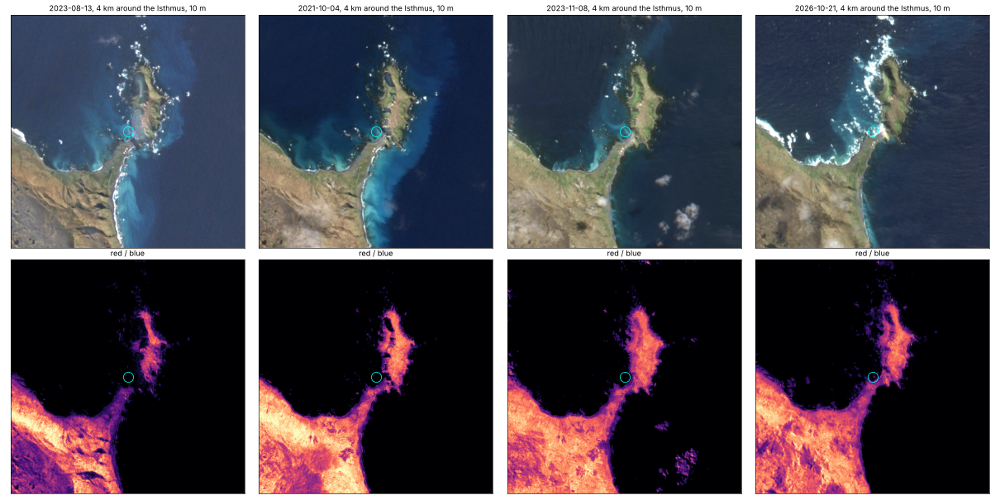

# Southern elephant seals (Mirounga leonina) on Macquarie and Heard islands

Status: first look done (2026-11-10), run in a cloud sandbox. Short answer: the data are there
for both islands, but neither radar at 20 m nor optical at 10 m shows the seals in a quick look.
See "First look" below.

Aim: see what public satellite data (DEA Sentinel-1 NRB radar, Sentinel-2 L2A) can say about
haul-out sites on Macquarie Island and Heard Island, and run it on Pawsey Setonix in the same way
as [tasmania-s1-change](https://github.com/mdsumner/tasmania-s1-change).

## Data

- **Sentinel-2 L2A** from the public `sentinel-cogs` bucket (us-west-2). MGRS tiles:
  - `57FVV`: all of Macquarie (Sandy Bay, the Isthmus, Hurd Point, Lusitania Bay)
  - `43FDB`: Heard Island; `43FCB`: Atlas Cove
  - Each item JSON sits next to its COGs, e.g.
    `https://sentinel-cogs.s3.us-west-2.amazonaws.com/sentinel-s2-l2a-cogs/57/F/VV/YYYY/M/<id>/<id>.json`,
    so no STAC API is needed (earth-search is blocked from some sandboxes anyway).
- **DEA Sentinel-1 NRB** (IW, per-burst COGs) in `s3://dea-public-data-dev/baseline/ga_s1_nrb_iw_hh_1/`,
  unsigned over HTTPS. Checked 2026-11-10:
  - **Heard:** HH, ascending, 12-day repeats on track 100 (bursts 214461-214465, iw1/iw2, near
    full island cover) and track 173 (371257-371261 iw3, about 95%). Dates: 6 Dec 2024 to
    29 Mar 2025 (moult season) and 5 Aug to 16 Oct 2026 (before and during breeding). Track 027
    items match the bounding box but do not actually cover the island.
  - **Macquarie:** nothing, in any DEA NRB product (hh, hh_hv, vv, vv_vh). Sentinel-2 only for now.
- **Sentinel-2 at Macquarie:** 372 L2A items on 57FVV for Aug-Nov 2019-2026; 40 under 40% tile
  cloud. Best clear island views (SCL clear fraction): 2021-10-04 (96%, right at the breeding
  peak), 2023-08-13 (90%), 2023-11-08 (89%), 2026-10-21 (82%).

## Science notes (untested)

- Elephant seals are 3-5 m long and lie on dark cobble and sand beaches. Individuals will not show
  at 10-20 m. Published satellite counts used about 0.5 m imagery (McMahon et al. 2014, PLoS ONE
  9(3): e92613, GeoEye-1, the Isthmus, Macquarie). At 10-20 m the best hope is a change signal on
  known beaches from dense harems or moult wallows: pre-season (August) vs peak (mid October).
- Seasons: breeding haul-out September to November (female peak about mid October); moult
  December to April.
- Easier 10 m targets on the same islands: penguin guano colonies (royal penguins at Hurd Point,
  king penguins at Lusitania Bay, and Heard's king penguin colonies), using a rock-masked red/blue
  ratio as in the earlier Amanda Bay emperor work.
- Heard is very cloudy, so expect few clear Sentinel-2 dates; S1 does not care about cloud.

## First look (2026-11-10)

**Heard, DEA S1 HH, track 100** (`docs/heard_s1_season.png`, `docs/heard_s1_zoom.png`)



- October minus August 2026 is dominated by snow and surface state: the glaciated interior
  darkens and the low coastal fringe brightens by 3-6 dB, and the moult season (Dec-Mar) vs
  August difference is even bigger. A 12-day reference pair (Aug vs late Aug/Sep) shows changes
  of the same size, so a 2-3 dB beach signal would be hard to separate from weather.
- No beach-scale patch stands out in the east (Spit Bay side) or Laurens Peninsula zooms.
  Breeding beaches on Heard are mostly narrow strips one to five 20 m pixels wide.

**Macquarie, Sentinel-2** (`docs/macquarie_s2_island.png`, `docs/macquarie_s2_isthmus.png`)



- The Isthmus beaches are a few 10 m pixels wide, and nothing at the Isthmus distinguishes
  2021-10-04 (breeding peak) from 2023-08-13 (before) or 2023-11-08 (after), in true colour or
  in a red/blue ratio. Seals on dark cobble have low contrast, and the surf line moves more
  than any seal patch would.

**So far:** individuals are out (expected), and dense harems are not obvious at 10-20 m without
help. Site positions on the figures are approximate and only for orientation.

## What would make it work

1. **Haul-out polygons and counts.** AAD ground counts or published beach lists for Heard and
   Macquarie (e.g. the Isthmus, Sandy Bay, Hurd Point; Spit Bay, Atlas Cove on Heard). With beach
   polygons, compute per-beach statistics through the season instead of looking at maps.
2. **Per-beach time series.** S1: mean HH dB per beach minus a nearby inland reference, per
   12-day date, Aug to Dec, so weather and snow cancel. S2: per-beach reflectance on clear dates.
   A harem signal should rise to mid-October and drop in November as females leave.
3. **Full DEA archive** (early 2027) to get every season, and Nov-Dec 2026 for the drop after weaning.
4. **Very high resolution** (0.3-0.5 m, e.g. Maxar via the AAD) for actual counts; use S1/S2 to
   pick dates and beaches.
5. **Penguins:** royal (Hurd Point) and king (Lusitania Bay) colonies are much larger and
   guano-stained, so they are better 10 m targets, using the same per-site approach.

## Setonix notes (from the Tasmania S1 run, which worked on 2026-11-10)

- **Environment:** no Docker on Setonix. Use a plain venv under `$MYSOFTWARE/venvs/<name>` and
  `pip install -r requirements.txt` (or `uv pip install -r requirements.txt`). The rasterio wheel
  bundles GDAL, so no GDAL module is needed.
- **Modules:** Setonix disables default module versions, so a bare `module load python` fails.
  Use `module load python/3.11.6` (the only `python/` module; `cray-python/3.12.12` also exists).
  The venv and the job must use the same module. The slurm files take `PYTHON_MODULE` and
  `SEALS_VENV` env vars to override both.
- **Paths:** account `pawsey1362`, partition `work`. Keep the repo in `$MYSOFTWARE`, write outputs
  to `$MYSCRATCH`. Scratch gets purged, so copy keepers off.
- **Logging:** set `PYTHONUNBUFFERED=1` in the job, or the `.out` log stays empty until the end.
- **Submit from inside the repo dir**, since the script is found via `$SLURM_SUBMIT_DIR`.
- **Network:** compute nodes reach `dea-public-data-dev` S3 over HTTPS (GDAL `/vsicurl/`, unsigned).
  `sentinel-cogs` (us-west-2) is untested from Setonix.
- **Caching gotcha:** in Tasmania a coarse smoke-test output was silently reused by the full run,
  because the skip-if-exists check ignored settings. Record the settings (overview level, boxcar,
  etc.) in GeoTIFF tags and only reuse a file when they match.
- **Timing reference:** Tasmania index (S3 listing of 9.8k bursts plus about 580 STAC JSONs) took
  about 2 min on a login node; 248 bursts at native 20 m took about 3 min on 1 node, 32 threads,
  96G. These islands are tiny by comparison, so one node with a few threads will be plenty.

### Setup (once, on a login node)

```bash
cd $MYSOFTWARE && git clone https://github.com/mdsumner/mi-island-s1-mirounga
module load python/3.11.6
python -m venv $MYSOFTWARE/venvs/seals
source $MYSOFTWARE/venvs/seals/bin/activate
pip install -r mi-island-s1-mirounga/requirements.txt
```

Then: `cd mi-island-s1-mirounga && sbatch --account=pawsey1362 setonix.slurm`.

## Run it

```bash
python seals.py index  --island heard        # ~4 min (S3 listing + item JSONs)
python seals.py s1     --island heard        # 42 date/track mosaics, 20 m, ~1.5 min
python seals.py figure --island heard
python seals.py index  --island macquarie --months 8 9 10 11   # ~1 min
python seals.py s2     --island macquarie --max-cloud 40        # 40 chips, ~2.5 min
python seals.py figure --island macquarie
```

`SEALS_WORK` and `SEALS_OUT` set the working and output folders (default `work/`, `out/`).
The S1 stack records its settings in GeoTIFF tags and S2 chips are only reused if their grid
matches, so a smoke-test run will not be silently reused. Timings above are from a cloud
sandbox; all of it fits on one Setonix node with a few threads.
